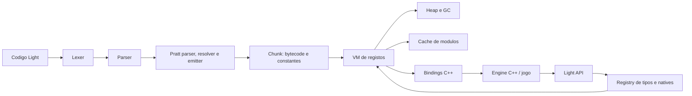
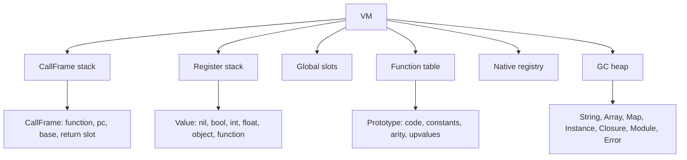
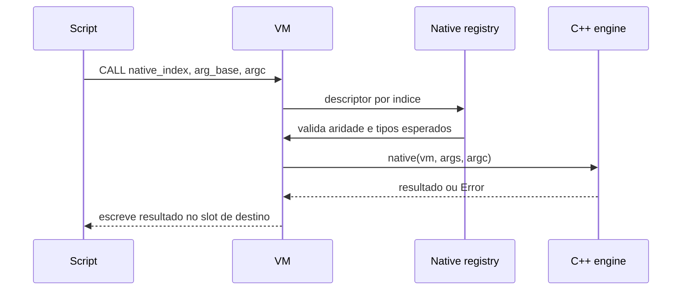
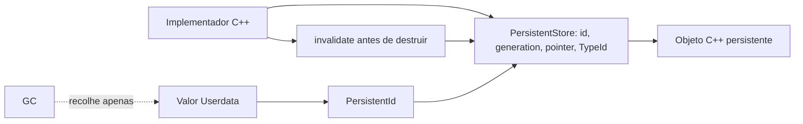
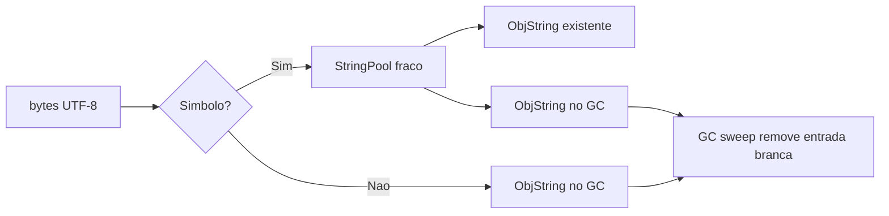
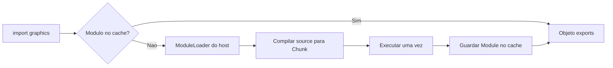

# Light VM: plano tecnico

## Objetivo

Construir uma VM embeddable para jogos, escrita em C++14, pequena e previsivel. A linguagem deve ser familiar a C++ sem tentar reproduzir C++: classes simples, `struct`, `enum`, funcoes, modulos e bindings nativos ergonomicos.

Prioridades, por ordem:

1. Tempo de frame previsivel e baixo overhead de chamadas nativas.
2. Portabilidade: desktop, Android e WebAssembly/Emscripten.
3. Runtime sem STL: sem containers, smart pointers, algoritmos ou strings de `std`.
4. Usar exclusivamente [akadjoker/containers](https://github.com/akadjoker/containers) e o seu allocator para arrays, strings, mapas e estruturas auxiliares.
5. Erros diagnosticaveis, limites explicitos e uma API C/C++ pequena para embedding.

O codigo em `estudos/toy_vm.c` e `estudos/toy_vm_nan.c` valida a direcao inicial: VM baseada em registos, instrucoes de 32 bits, frames separados e globais por indice. O fonte de Lua 5.4.9 em `estudos/lua-5.4.9` e referencia para parser, closures, GC e corrotinas, nao uma dependencia nem um desenho a copiar integralmente. O fonte do quickjs-ng em `estudos/quickjs` e referencia para typed arrays/ArrayBuffer, dispatch do interpretador, X-macros de opcodes e workflow de CI (ver seccao "Referencias adotadas do quickjs-ng").

## Decisoes de arquitetura

| Area | Decisao inicial | Motivo |
| --- | --- | --- |
| Execucao | VM interpretada baseada em registos | Menos operacoes de stack, bons bindings e caminho ja provado pelos estudos. |
| Compilador | Pratt parser -> AST por funcao em arena -> type check -> emissao | Tipagem estrita e diagnosticos precisam de ver a expressao completa; a arena e reposta por funcao, pico de memoria limitado a maior funcao. |
| Bytecode | Instrucao fixa de 32 bits e formato `.lbc` serializavel desde M1 | Decoding simples, assets precompilados e compatibilidade validada por versao. |
| Tipos base | `u8`, `i8`, `u16`, `i16`, `u32`, `i32`, `u64`, `i64`, `f32`, `f64` | Larguras estaveis para VM, bytecode, serializacao e ABI. |
| Tipagem | Assinaturas estritas verificadas no compilador | Tipos, aridade, `this`, `super`, `&` e generics nao fazem lookup ou reflexao no runtime. |
| Valores | `Value` tagged union com `i64` ou `f64` no payload | Variaveis e registos dinamicos preservam inteiros sem os converter sempre para `double`; NaN boxing fica para benchmark posterior. |
| Memoria | Heap proprio com mark-and-sweep tri-color incremental | Evita pausas longas no frame e controla todas as alocacoes geridas. |
| Foundation | `akadjoker/containers` como dependencia obrigatoria | Fornece containers, strings e allocator sem introduzir STL no runtime. |
| Globais e membros conhecidos | Slots indexados resolvidos no compilador | Acesso direto `O(1)` durante execucao. |
| Campos dinamicos e exports | Hash map do repositorio | Necessario apenas onde a forma do objeto nao e conhecida estaticamente. |
| Natives | Tabela de descriptors indexada e ABI de stack/slots | Evita lookup por nome no hot path e permite validar argumentos. |
| Modulos | Objetos `Module` com tabela de exports, cache por nome/caminho | Importacao uma vez, experiencia proxima de Python. |
| Dados em massa | `Buffer<T>` tipado no heap GC e, na fase 2, views sobre memoria do host | Storage com largura real (`u8` = 1 byte), GC nao percorre o conteudo, zero-copy para OpenGL/engine. |
| I/O | Zero I/O no core; callbacks `alloc`/`print`/`load_module` na `VmConfig` | Mesmo core em desktop, Android e WASM; defaults por plataforma em `platform/`. |
| C++ | C++14, sem excecoes atraves da fronteira da VM | Erros da linguagem usam objetos `Error` e retorno de estado. |

A implementacao nao deve assumir que ponteiros cabem em 48 bits. Portanto, NaN boxing so sera considerado depois de existirem testes em x86_64, Android e Emscripten. O formato deve guardar handles/indices para objetos em vez de ponteiros crus no payload.

### Regra sem STL

Todo o codigo em `src/` usa `ct` como base: arrays dinamicos, listas, mapas, strings e alocacao. Nao incluir headers STL, incluindo `vector`, `string`, `unordered_map`, `memory`, `functional`, `algorithm`, `optional` e `variant`. A fronteira publica pode aceitar tipos da plataforma quando inevitavel, mas deve converte-los imediatamente para tipos `ct`; a VM nao pode guardar nem propagar tipos `std`.

A dependencia fica versionada no repositorio, preferencialmente como submodule em `third_party/containers/` ou por CMake `FetchContent` com commit fixado. O build exporta apenas os includes de `ct` para `src/` e adiciona uma verificacao de CI que falha quando `src/` inclui um header STL.

## Arquitetura



### Runtime



Cada chamada cria um `CallFrame` com `base` no array de registos. Os argumentos vivem em slots contiguos a partir de `base`; os temporarios sao slots atribuidos pelo compilador. Uma chamada native recebe a VM e o intervalo de slots de argumentos, escreve os resultados numa posicao acordada e devolve um estado de sucesso ou erro.



## Modelo de objetos e memoria

Todos os objetos geridos comecam com um header:

```cpp
struct GcObject {
		GcObject* next;
		uint8_t type;
		uint8_t color;
		uint16_t flags;
};
```

A VM e dona apenas do heap de objetos de script. Codigo host nao retem ponteiros `GcObject*` entre chamadas sem os registar como raiz. A API publica usa `Handle`, um indice numa tabela de handles enraizados pela VM.

O GC sera tri-color incremental:

1. **Mark roots**: globais, registos dos frames, modulos carregados, handles host, registry de natives/tipos e upvalues abertas.
2. **Propagate**: processar uma quantidade fixa de objetos ou bytes por passo, pintando referencias alcancaveis de cinzento para preto.
3. **Sweep**: percorrer a lista de objetos e libertar os brancos incrementalmente.
4. **Write barrier**: ao guardar uma referencia branca num objeto preto, marcar o objeto pai para preservar a invariante tri-color.

O engine chama `vm.gc_step(budget_bytes)` no fim de cada frame ou a cada N alocacoes. A primeira versao pode concluir um ciclo inteiro em pontos seguros, mas a write barrier deve existir desde o inicio para nao alterar o modelo de objetos mais tarde.

### Objetos C++ persistentes

Objetos criados e detidos pelo implementador C++ nao entram no heap do GC. A VM mantem um `PersistentStore` com slots `PersistentId { index: u32, generation: u32 }`; cada slot aponta para o objeto C++, para o `TypeId` e para uma callback opcional de notificacao. Um valor de script `Userdata` guarda apenas esse `PersistentId` e o seu tipo, nunca toma ownership do ponteiro C++.

O GC pode recolher o pequeno wrapper `Userdata`, mas nunca destroi o objeto C++ persistente. O host controla a memoria e deve chamar `vm.invalidate(persistent_id)` antes de destruir o objeto. Qualquer acesso posterior falha com `Error` em vez de usar um ponteiro invalido. `generation` impede que um slot reutilizado seja confundido com o objeto anterior.



### LightData: structs sem construtor

`LightData` e o caminho para expor structs C++ simples, alocadas e possuidas pelo host. E memoria bruta com layout conhecido, sem construtor, destrutor, heranca, metodos virtuais ou alocacao da VM. Exemplos: `Vec2`, `Color`, `Transform`, estado de entidade e configuracoes. O host pode guarda-los em arena, pool ou memoria estatica; o GC nunca os visita nem os destroi.

Cada `LightDataType` e registado com `size`, `alignment` e descriptors de campo `{ SymbolId name, u32 offset, ValueKind kind }`. A VM le/escreve campos por offset somente depois de validar o `PersistentId`, o `TypeId`, os limites `offset + sizeof(kind)` e mutabilidade do campo. Isto permite opcodes diretos `GET_DATA_FIELD` e `SET_DATA_FIELD`, sem lookup de nome nem chamada native no hot path.

```cpp
struct TransformData {
	f32 x;
	f32 y;
	f32 rotation;
};

DataBuilder transform = gfx.data("Transform", sizeof(TransformData), alignof(TransformData));
transform.field("x", offsetof(TransformData, x), ValueKind::F32);
transform.field("y", offsetof(TransformData, y), ValueKind::F32);
transform.field("rotation", offsetof(TransformData, rotation), ValueKind::F32);
```

`LightData` nao suporta referencias para objetos GC, `ct::String`, containers `ct`, ponteiros proprietarios ou qualquer campo que exija lifecycle. Para passar referencias, usar `PersistentId` explicito como `u64`, ou uma classe/objeto adequado. O descriptor e persistente no registry e o compilador resolve cada campo conhecido para um indice; a classe `TransformData` C++ nunca e instanciada pela VM.

### Buffer\<T\>: typed buffers

`Buffer<T>` e um objeto GC com storage de largura real: `Buffer<u8>` com 1M de elementos ocupa ~1 MB, nao os 16 MB que um array de `Value` ocuparia. `T` e um dos dez tipos numericos; nunca objetos, strings ou referencias — e essa restricao que o torna barato. Header (`length: u32`, `ElementKind`, flags) e dados vivem numa unica alocacao.

```light
Buffer<u8> tiles = Buffer<u8>(1024);
tiles[i] = 255;
u8 t = tiles[i * width + j];
```

- O GC marca o header e nunca percorre o conteudo. Sem write barriers nos elementos, porque nao ha referencias la dentro. Um buffer de 10 MB custa ao mark o mesmo que um de 10 bytes.
- Os bytes do backing store contam para a pressao de GC do `gc_step`/threshold. (O quickjs nao o faz — alocar um ArrayBuffer de 100 MB nao dispara GC la — e num jogo onde buffers dominam o heap isso significa nunca colecionar. Erro a nao repetir.)
- Opcodes `BUFFER_GET`/`BUFFER_SET` com um unico bounds check unsigned `idx >= count`. O compilador conhece `T` estaticamente (via `<T>`/`TypeId`) e valida `tiles[i] = 300` contra `u8`; o registo continua `i64`/`f64` com extensao no load — so a storage e compacta.
- O objeto guarda o ponteiro para os dados ja pre-somado e `count` em elementos (padrao `u.array` do quickjs): o fast path le dois campos contiguos e nao toca em mais nenhuma struct.
- Invalidacao = por `count = 0`: o mesmo bounds check cobre out-of-range e buffer invalidado, sem teste extra no hot path.
- Tamanho do elemento derivado por tabela `size_log2[kind]` — shifts em vez de mul/div.

Fase 2 (depois do `PersistentStore` estar testado): **views sobre memoria do host** — vertex buffers, pixel data, audio — com a mecanica `PersistentId`/generation; `vm.invalidate()` poe `count = 0` na view. O buffer mantem uma lista intrusiva das suas views para invalidar/reapontar em O(views) sem alocar. Caso de uso alvo, identico a TypedArray/WebGL: `gfx.buffer_data(target, verts)` recebe `Buffer<f32>`, valida o `TypeId`, e entrega `ptr + byte_length` ao driver sem copias.

Regra de reentrancia (licao do quickjs): depois de qualquer chamada que possa reentrar na VM, reler `count`/ptr — nunca fazer cache de ponteiros de buffer atraves de uma call. Buffers redimensionaveis, `DataView` e buffers partilhados entre threads ficam fora da v1.

### Classes

`class` e diferente de `LightData`: representa comportamento, metodos e metadados de tipo. Uma instancia de classe criada pelo script e `ObjInstance` no GC. Uma instancia C++ persistente exposta como classe usa o mesmo `PersistentStore`, mas os acessos chamam methods registrados e nunca assumem layout interno por offset.

Classes suportam heranca simples em cadeia: `class B extends A` e `class C extends B`. Cada classe tem no maximo um `parent: ClassType*`, mas nao existe limite artificial de profundidade. Na compilacao, campos e metodos herdados recebem slots estaveis; um override reutiliza o slot do metodo do pai. `this` e o slot 0 e `super.method()` emite chamada direta ao slot definido no pai imediato. Sem heranca multipla, mixins ou lookup dinamico na primeira versao.

### Strings

Todas as strings da linguagem sao `ObjString` imutaveis e pertencem ao heap do GC. O objeto guarda `length: u32`, `hash: u32` e os bytes UTF-8; os bytes devem ser alocados com o proprio objeto ou pelo allocator de `ct`, nunca por `std::string`. Literais carregados do bytecode e strings dinamicas seguem o mesmo tipo e ciclo de vida.

O `StringPool` nao e dono das strings: e uma hash table **fraca** `hash + bytes -> ObjString*`, implementada com `ct`. E usado apenas por identificadores, nomes de campos/metodos, nomes de modulo e nomes de exports. Ao pedir `intern(bytes)`, o pool devolve a instancia existente ou cria uma `ObjString`; assim, comparar simbolos pode usar igualdade de ponteiro depois de confirmar o hash. O pool nao e raiz do GC.

Durante sweep, antes de libertar uma `ObjString` branca, remover a sua entrada do `StringPool`. Em alternativa, limpar todas as entradas cujo objeto nao ficou marcado antes da fase sweep. Isto impede que identificadores de modulos descarregados e codigo compilado temporariamente fiquem retidos para sempre.

Strings comuns de gameplay, UI, rede, ficheiros e concatenacoes **nao sao internadas**. Sao recolhidas normalmente quando deixam de ser alcancaveis. As strings de constantes vivem enquanto o `Chunk`/`Prototype` que as referencia estiver marcado; os nomes de natives e classes vivem enquanto o registry host, que e uma raiz, estiver registado na VM.



## Linguagem e compilador

O pipeline de compilacao tem quatro passos, todos por modulo/funcao, sem AST persistente:

1. **Pre-passe de declaracoes**: scan rapido ao nivel do modulo que recolhe assinaturas de funcoes, classes e campos (sem corpos), para suportar forward references e referencias mutuas.
2. **Parser Pratt -> AST por funcao**: os nos sao um unico struct POD `Node` com tagged union por `NodeKind` (mesma filosofia do `Value`), alocados numa arena `ct` via `AstBuilder` (factory que aplica limites de nos e profundidade de recursao). Sem hierarquia OOP, sem Visitor com virtuais.
3. **Type check**: walk com `switch (kind)` que anota `node->type`, resolve conversoes implicitas, `TypeId`, slots e indices.
4. **Emissao**: segundo walk que gera o `Chunk`. So corre com zero erros.

A arena e reposta no fim de cada funcao (parse -> check -> emit -> reset), por isso o pico de memoria e o tamanho da maior funcao e nao existe custo em runtime — em producao o jogo carrega `.lbc`, nao compila. Os walks separados tornam cada fase testavel isoladamente (golden tests do AST tipado antes do emitter existir).

### Tipos de largura fixa

Criar `light_types.h`, baseado em `<stdint.h>`, com aliases no namespace `light`:

```cpp
using u8 = uint8_t;
using i8 = int8_t;
using u16 = uint16_t;
using i16 = int16_t;
using u32 = uint32_t;
using i32 = int32_t;
using u64 = uint64_t;
using i64 = int64_t;
using f32 = float;
using f64 = double;
```

Estes aliases sao obrigatorios no runtime, bytecode, containers da VM e API nativa. Nao usar `int`, `long`, `size_t` ou enums sem tipo subjacente em dados persistidos. `usize` pode existir apenas para tamanhos e indices em memoria, nunca no formato `.lbc`.

Na linguagem, `u8`, `i8`, `u16`, `i16`, `u32`, `i32`, `u64`, `i64`, `f32` e `f64` sao tipos reais: o compilador verifica conversoes, overflow e compatibilidade de assinatura. Nos registos, todo inteiro e guardado como `i64` com extensao de sinal ou zero e todo float como `f64`; o tipo estatico e mantido pelo compilador. Isto nao e acucar nem converte tudo para `double`: `u8(255)` fica inteiro e operacoes inteiras usam o fast path de `i64`.

`Value` e dinamico porque arrays, globals, campos dinamicos e resultados de chamadas podem transportar tipos diferentes. Logo, um registo nao pode ocupar apenas 1 byte quando pode conter `u8`, `f64`, string, closure ou `Userdata`. A primeira versao usa tag mais payload, normalmente 16 bytes em 64-bit por alinhamento. Tentar forcar 8 bytes desde o inicio exige NaN boxing e limita o payload a 48 bits; nao e uma decisao segura para Android/WASM sem benchmarks e testes. `LightData` e typed buffers guardam os seus campos com o tamanho real (`u8` ocupa 1 byte, `f32` ocupa 4 bytes), pois nao usam `Value` por campo.

### Constantes e valores imediatos

O bytecode usa a representacao mais pequena que preserve o tipo, independentemente do tamanho do `Value` em runtime:

| Valor source | Representacao `.lbc` | Instrucao de carga |
| --- | --- | --- |
| `true`, `false`, `nil` | opcode sem constante | `LOAD_BOOL`, `LOAD_NIL` |
| inteiros pequenos | imediato `i16` em `AsBx` | `LOAD_I16` |
| `i32`, `u32` | constante tipada de 4 bytes | `LOAD_K` |
| `i64`, `u64`, `f64` | constante tipada de 8 bytes | `LOAD_K` |
| `f32` | constante tipada de 4 bytes | `LOAD_K` |
| string | bytes UTF-8 uma vez no pool | `LOAD_K` |

O constant pool nao elimina o `Value`: apenas evita repetir literais grandes no `.lbc` e no code stream. `LOAD_K` faz uma leitura indexada do pool e cria/copia o `Value` para o registo; nao faz hash lookup. O gargalo so aparece se um loop executar `LOAD_K` continuamente. O emitter deve usar imediatos para `nil`, bool e inteiros `i16`, e carregar constantes invariantes fora do loop sempre que possivel. Esta escolha deve ser medida por contadores de opcode antes de adicionar superinstrucoes ou NaN boxing.

### Sintaxe inicial da linguagem

Comentarios seguem C++: `//` ate ao fim da linha e `/* ... */`, incluindo comentarios multilinha. O lexer elimina-os; nunca chegam ao bytecode, exceto quando debug symbols guardam linhas de source.

Strings normais usam `"..."` com escapes C usuais (`\n`, `\t`, `\\`, `\"`, `\xNN`). Interpolacao usa exclusivamente `f"...{expressao}..."`, como Python. Chaves em strings normais nao tem significado especial; em f-strings, `{{` e `}}` representam chaves literais. A f-string e dividida pelo lexer e compilada para loads de literais e `CONCAT`/`TOSTRING`; nao existe parser ou formatador dinamico no runtime.

Declaracoes sao C-style, sem `var` e sem inferencia de tipos: o tipo vem primeiro.

```light
u8 flags = 0;
f32 speed = 2.5f;
Sprite player = entity.get<Sprite>();
```

Statement que comeca com keyword de tipo built-in e declaracao; para tipos do utilizador, a sequencia `identificador identificador` nunca e expressao valida, portanto um token de lookahead decide (o type check valida depois se o nome e mesmo um tipo). Como `<T>` so existe em call sites na v1, nao ha a ambiguidade C++ de `Map<u32> m` vs comparacao.

Funcoes exigem assinatura completa, incluindo retorno; parametros seguem o mesmo estilo C, com `&` antes do tipo para referencias:

```light
def clamp(f32 value, f32 minimum, f32 maximum): f32 {
	if (value < minimum) return minimum;
	if (value > maximum) return maximum;
	return value;
}

def reset_position(&Transform position): void {
	position.x = 0.0f;
	position.y = 0.0f;
}
```

`void` significa zero valores de retorno. `&Transform position` exige uma variavel mutavel compativel no call site e passa uma referencia de escrita para a funcao; e o mecanismo para out/inout parameters. Referencias `&` nao podem ser capturadas por closures nem atravessar `yield` de corrotinas — verificado pelo compilador, senao viram use-after-free de slots de registo.

A linguagem suporta zero, um ou varios retornos, sempre com aridade e tipos definidos na assinatura:

```light
def split_size(u32 size): (u16, u16) {
	return u16(size >> 16), u16(size);
}

u16 width, _ = split_size(packed_size);
u16 x, u16 y = split_size(packed_size);
```

`_` e um destino de descarte, nao uma variavel. Pode aparecer em declaracao, atribuicao e argumentos de retorno, mas nao pode ser lido. `return` tem de fornecer exatamente a aridade declarada; `void` exige `return;` ou fim da funcao. O compilador aloca resultados em slots contiguos e emite `CALL`/`RETURN` com `result_count: u8`; o caller descarta slots marcados `_` sem criar `Value` observavel. Isto suporta a ergonomia de Python sem listas temporarias, tuples obrigatorios ou lookup no runtime.

Classes recebem `this` como local implicito no slot 0. `super.method(args)` e valido apenas em metodo de classe e e resolvido pelo compilador para o slot do metodo na classe pai. `this.field` e campos conhecidos resolvem para offsets/indices; o runtime recebe apenas instrucoes diretas, nao nomes de membros.

### Generics de tipo `<T>`

`<T>` e uma feature geral de tipo na sintaxe. A primeira entrega suporta argumentos de tipo em chamadas e membros, para APIs C++ e para APIs da linguagem:

```light
GameObject component = entity.add<GameObject>();
Sprite sprite = entity.get<Sprite>();
```

`<T>` nesta fase nao cria templates de funcoes nem instanciacao runtime. Cada argumento tem de resolver para um `TypeId` conhecido, seja tipo built-in, `LightData`, classe script ou tipo C++ registado antes de `freeze_bindings()`. O compilador valida a assinatura e emite o `TypeId` como operando/imediato da chamada. A VM nunca procura o nome de `T` por string durante o frame. A sintaxe permite que qualquer binding a use, mas a semantica concreta pertence ao descriptor da funcao; nao existe opcode especial `add_component`.

### Bytecode serializavel desde M1

O formato e `.lbc` e usa little-endian. O loader nunca faz cast de bytes para structs C++; le cada campo explicitamente, verifica limites antes de alocar e rejeita ficheiros malformados. A primeira versao do header e:

```text
magic[4] = "LBC\0"
major: u16
minor: u16
flags: u32
payload_size: u32
checksum: u32
```

O payload contem um `Module` raiz e uma arvore de `Prototype`: aridade, numero de registos, constantes tipadas, instrucoes `u32`, descritores de upvalue e informacao de debug opcional. Strings sao codificadas como `byte_length: u32` seguido de bytes UTF-8, nunca como ponteiros. Referencias entre objetos serializados usam indices locais, nunca enderecos. Natives, pointers C++ e recursos da engine nao sao serializados: o host regista-os antes de executar o bundle.

O opcode e `u8`; as tres codificacoes iniciais sao `ABC`, `ABx` e `AsBx`, todas numa palavra `u32`. A numeracao dos opcodes faz parte da compatibilidade do bytecode: nunca reordenar opcodes publicados, apenas acrescentar novos no fim e incrementar `major` se a semantica mudar.

| Entrega | Sintaxe | Bytecode/estrutura necessaria |
| --- | --- | --- |
| M1 | literais, variaveis, expressoes, `if/else`, `while`, `break`, `continue` | loads/stores, aritmetica, comparacoes, saltos relativos. |
| M2 | `for`, `foreach`, funcoes estritas, `void`, parametros `&`, retornos multiplos e `_` | iterador, `CALL`, `RETURN`, `Prototype`, call frames, `result_count` e validacao de assinatura. |
| M3 | funcoes anonimas e closures | upvalue descriptors, upvalues abertas/fechadas, `Closure`. |
| M4 | `struct`, `class`, `extends`, metodos, `this`, `super`, `enum`, `::`, `<T>` e `Buffer<T>` | `LightDataType` para structs POD, `ClassType`, `TypeId`, slots de campo/metodo, dispatch e opcodes `BUFFER_GET`/`BUFFER_SET`. |
| M5 | `import` e `export` | `Module`, loader configuravel e cache. |
| M6 | corrotinas | `Coroutine` com os seus frames, registos e estado. |
| M7 | `switch/case` | jump table para casos inteiros densos; cadeia de comparacoes nos restantes. |

`try/catch/finally` fica fora do nucleo inicial. Introduzi-lo depois de closures e corrotinas requer unwinding de frames, handlers por frame e garantia de `finally` durante erro, return e cancelamento de coroutine. O mecanismo de `Error` deve existir desde M1; a sintaxe `try` so entra quando esses invariantes estiverem testados.

### Resolucao de nomes

A ordem de resolucao e local -> upvalue -> global indexado -> import/export. O compilador mantem uma tabela de simbolos por scope e converte referencias conhecidas em indices. Lookups por string nao pertencem ao interpretador normal, apenas ao loader, debug e propriedades dinamicas.

### Diagnosticos, linha e coluna

O compilador acumula diagnosticos em vez de abortar no primeiro erro:

```cpp
struct Diagnostic {
	ErrorCode code;      // enum estavel — os testes comparam codigo + posicao, nunca o texto
	u32 offset;          // byte offset no source
	u32 length;          // extensao do span, para sublinhar o troco exato
	ct::String message;
};
```

O parser recupera por panic mode (sincroniza em `;`, `}` e keywords de inicio de statement) e o no falhado vira `NodeKind::Error`; o type check ignora subarvores com erro e marca expressoes invalidas com `TypeId::Invalid` para nao gerar erros em cascata — um erro real, uma mensagem. Limite configuravel de diagnosticos por compilacao. O emitter so corre com zero erros.

Tokens e nos de AST guardam apenas o byte offset (4 bytes); o lexer constroi uma line table (offset de inicio de cada linha) e linha/coluna derivam por binary search **apenas no caminho de erro** — o caminho quente nunca paga. O `.lbc` guarda so a linha por instrucao (delta-encoded, na seccao de debug opcional): coluna pertence aos erros de compilacao, linha aos stack traces de runtime.

Em runtime, `vm.execute()` devolve status e, num erro, um objeto `Error` com `ErrorCode`, mensagem e stack trace — construido no momento do erro (antes de desenrolar os frames), percorrendo os `CallFrame` e mapeando pc -> linha.

O **disassembler existe desde M1** (~200 linhas, um switch sobre opcodes, sai pelo callback `print`): serve o desenvolvimento do emitter, os golden tests (source -> disasm esperado, mais legivel que comparar bytes) e o diagnostico de falhas. Debugger interativo fica pos-M5; a `VmConfig` reserva desde ja um hook opcional (por linha/call/return, estilo Lua) sobre o qual breakpoints e stepping se constroem sem tocar no loop de execucao.

## Modulos estilo Python



Um modulo tem nome canonico, `Chunk` opcional, estado (`loading`, `loaded`, `failed`) e tabela de exports. Durante `loading`, o cache devolve o mesmo objeto para suportar imports circulares controlados. O host fornece `ModuleLoader`; por defeito ele pode carregar ficheiros, mas no mobile/WebAssembly deve tambem aceitar assets empacotados ou fontes precompiladas.

`import graphics` liga o objeto de exports a um slot local. `from graphics import draw` pode ser adicionado mais tarde como acucar sintatico. `export` e explicito; variaveis de modulo nao exportadas permanecem privadas.

### Reload

A implementacao e pos-M5, mas duas regras valem desde o M5 para nao o inviabilizar:

1. Imports ligam-se a tabela de exports do modulo com uma indirecao — nunca copiam o valor resolvido para os slots do importador. (Cache em registo dentro de uma funcao e permitida; e o trade-off do Lua.)
2. Slots de export sao estaveis por nome entre recompilacoes: no reload, exports existentes mantem o slot, novos vao para o fim, removidos ficam com `Error` sentinela.

Com isso, reload = recompilar o modulo, executa-lo de novo e substituir o conteudo dos slots de export; todos os importadores veem a versao nova no acesso seguinte. Closures ja criadas continuam a apontar para os `Prototype` antigos ate serem recriadas (o GC liberta os antigos quando ninguem os referencia). Migracao de estado de instancias vivas fica explicitamente fora de scope.

## API de embedding e bindings

A API deve separar registo, execucao e ownership. O host regista todas as constantes, funcoes e tipos antes de compilar ou carregar modulos; depois chama `freeze_bindings()`. O freeze atribui indices estaveis para o compilador e impede alteracoes de ordem que invalidariam bytecode ja serializado.

### VmConfig: I/O so por callbacks

O core nao possui nenhum canal de I/O: `src/` fora de `platform/` nao inclui `<stdio.h>` nem toca no filesystem (verificado em CI, junto com o check anti-STL). Todo o I/O entra por callbacks na `VmConfig` — ponteiro de funcao + `void* userdata`, sem `std::function`:

```cpp
enum class LogLevel : u8 { Info, Warn, Error };

struct ModuleSource {
	const u8* bytes;
	u32 length;
	bool is_bytecode;   // true = .lbc precompilado, false = source Light
};

struct VmConfig {
	void* (*alloc)(void* ud, void* ptr, usize old_size, usize new_size); // estilo lua_Alloc
	void* alloc_ud;
	void (*print)(void* ud, LogLevel level, const char* bytes, u32 length);
	void* print_ud;
	bool (*load_module)(void* ud, const char* name, u32 name_len, ModuleSource* out);
	void (*release_module)(void* ud, ModuleSource* src);
	void* loader_ud;
};
```

- `print` e o canal de **todo** o output da VM: native `print` do script, erros de runtime, stack traces, diagnosticos do compilador e disassembler, com `LogLevel` para o host filtrar. Recebe bytes + length porque `ObjString` nao e null-terminated.
- `load_module` recebe o nome do import tal como escrito — a VM nao faz nenhuma manipulacao de paths — e devolve source ou `.lbc` (`is_bytecode`); e o host que decide "usa o `.lbc` se existir". A VM usa os bytes durante o load e chama `release_module`; nunca guarda o ponteiro, por isso o host pode servir mmap, asset Android ou buffer estatico sem copias.
- `alloc` permite arena/pool do host, teto de memoria por VM (mods sandboxed) e instrumentacao de alocacoes sem tocar no core.

Defaults opcionais por plataforma em `platform/` (o embedder pode nem os linkar): desktop escreve em `stdout`/`stderr` e carrega via `fopen`; Android usa `__android_log_print` com `%.*s` (os bytes nao sao null-terminated) e `AAssetManager`; Emscripten usa `emscripten_log` e o FS virtual. A selecao e feita no build (CMake escolhe o `platform/*.cpp`), nao por `#ifdef` gigante.

```cpp
Vm vm(config);
ModuleBuilder gfx = vm.begin_module("gfx");
gfx.constant("SCREEN_WIDTH", i32(1280));
gfx.constant("PI", f32(3.14159265f));
gfx.function("draw_rect", native_draw_rect, NativeSignature::fixed(4));

TypeBuilder sprite = gfx.external_type("Sprite");
sprite.method("set_position", sprite_set_position, NativeSignature::fixed(2));
sprite.method("destroy", sprite_destroy, NativeSignature::fixed(0));

vm.freeze_bindings();
vm.execute(module_or_chunk);
vm.gc_step(budget_bytes);
```

`ModuleBuilder` cria modulos nativos, incluindo constantes imutaveis e funcoes. `DataBuilder` regista layouts `LightData`; `TypeBuilder` regista classes e metodos. Cada native tem nome para diagnostico, indice usado pelo bytecode, aridade minima/maxima e validadores de tipo. A API nao usa `std::function`, `std::string` ou ownership implicito; os nomes entram no `StringPool` e os descriptors usam containers `ct`.

Para expor uma instancia persistente, o host regista-a e entrega ao script o `Userdata` correspondente:

```cpp
PersistentId player_id = vm.persist(&player, sprite.type_id());
Value player_value = vm.external_value(player_id);
vm.set_global("player", player_value);

// Antes de destruir player no C++:
vm.invalidate(player_id);
```

`persist()` e `invalidate()` sao operacoes do host, nao instrucoes do script. A VM nao tem callback de delete para objetos persistentes. Tipos que a VM realmente possui, como strings, arrays e closures, continuam a usar o GC normalmente.

Bindings gerados ou registados por macros podem ser estudados depois de a API manual estar estavel. A versao inicial deve privilegiar mensagens de erro claras e custo previsivel, nao magia de templates.

## Referencias adotadas do quickjs-ng (`estudos/quickjs`)

Extraidas do estudo do fonte (quickjs.c, quickjs-opcode.h) e adaptadas ao desenho da Light:

| Ideia | Onde no quickjs | Aplicacao na Light |
| --- | --- | --- |
| Ponteiro pre-somado + `count` em elementos cached no objeto | quickjs.c:1180-1203, 61600-61627 | Fast path de `Buffer<T>` le dois campos contiguos, zero indirecoes extra |
| Invalidar/detach = `count = 0` em todas as views | quickjs.c:59378-59409 | `invalidate()` de views host gratis no hot path; um unico bounds check unsigned cobre tudo |
| Lista intrusiva buffer -> views; guard `link.next != NULL` nos finalizers | quickjs.c:59256-59292, 61877-61890 | A ordem de finalizacao no GC e arbitraria; sem o guard ha double-unlink |
| `gc_mark = NULL` para buffers | quickjs.c:2238 | Mark nunca percorre dados numericos |
| Threshold de GC adaptativo: proximo ciclo a 1.5x do live set | quickjs.c:1682-1701 | Base para o trigger do `gc_step` |
| Converter o valor **antes** do bounds check | quickjs.c:10837-10848 | Reentrancia em script pode invalidar buffer; reler `count`/ptr apos qualquer call |
| Computed goto em que cada handler termina com o seu proprio dispatch (`BREAK` = novo goto), com macros que tambem compilam como `switch` no MSVC | quickjs.c:18051-18067 | Loop da VM no porte do toy_vm: um branch site por opcode para o predictor |
| X-macro unico gera enum + dispatch table + metadata | quickjs-opcode.h | `light_opcodes.def` gera enum, tabela do disassembler e validacao — impossivel dessincronizar |
| Formas curtas de opcode e superinstrucoes guiadas por profile | quickjs-opcode.h:300-340 | Confirma a regra "medir com contadores antes de otimizar" |
| `cur_pc` materializado so antes do slow path | quickjs.c:19879 | pc escrito apenas quando erro/stack trace pode observa-lo |
| Frame numa alocacao contigua com tamanho estatico e um so check de overflow a entrada | quickjs.c:18116-18139 | Valida o desenho `CallFrame`/`base` com `frame_size` pre-calculado |
| `size_log2` por tipo de elemento | quickjs.c:59056-59061 | Shifts em vez de mul/div nos acessos a buffer |

Nota: o quickjs **nao** contabiliza os bytes dos ArrayBuffers na pressao de GC (o trigger so corre na criacao de objetos) — e a unica licao pela negativa; a Light contabiliza (ver seccao `Buffer<T>`).

## CI

Decalcado dos workflows do quickjs-ng (`estudos/quickjs/.github/workflows/`):

- **`ci.yml`**: matriz com `fail-fast: false` — Linux gcc/clang (Debug/Release), **ASan+UBSan** e **MSan** a correr a suite completa com `halt_on_error=1`, Windows MSVC, macOS, x86 32-bit (apanha bugs de ponteiro-nao-e-64-bits antes da decisao NaN boxing), **Android NDK arm64** e **Emscripten** — os dois ultimos a correr os testes (node/wasmtime), nao so a compilar. Filtros de paths para docs/README nao dispararem CI.
- **`gc-stress.yml`**: build com `LIGHT_GC_STRESS` — ciclo completo de GC antes de **cada** alocacao + verificacao da invariante tri-color — a correr a suite toda, com ASan ligado. Transforma raizes esquecidas e write barriers em falta em crashes deterministicos no CI.
- **`valgrind.yml`**: so em push a master (`--leak-check=full --track-origins=yes`), apanha o que o ASan nao apanha.
- Jobs pequenos de contrato: check anti-STL e anti-`<stdio.h>` em `src/`; compilar `light_api.h` sozinho com `-Wall -Wextra -Werror -pedantic` em C++14 puro (o `cxxtest` deles); build sem compilador (`LIGHT_DISABLE_COMPILER`, o `parserless` deles) que prova que shipping so com `.lbc` linka sem `compiler/`; se houver ficheiros gerados (opcodes), job que os regenera e falha se o git tree ficar sujo.
- Alvos de fuzzing por componente (lexer, parser, loader `.lbc`), estilo `fuzz.c` deles, corridos no passo 10 do roadmap.

## Estrutura proposta

```text
src/
	light_api.h              API publica para o host
	vm.h / vm.cpp            loop de execucao e frames
	value.h                  Value e operacoes de tipo
	bytecode.h               opcodes, Chunk e Prototype
	compiler/                token, lexer, ast, ast_builder, parser, symbols, typecheck e emitter
	runtime/
		gc.h / gc.cpp          heap, raizes, tri-color e barriers
		object.h               tipos de objetos geridos
		light_data.h           layouts POD, fields por offset e DataBuilder
		buffer.h               Buffer<T>: storage tipado, views host e invalidacao
		string_pool.h          internamento de identificadores
		module.h               Module e cache
		native.h               descriptors e chamada native
		persistent.h           PersistentStore, ids e Userdata externo
	stdlib/                  modulos escritos em C++
	platform/                loader de ficheiros/assets por plataforma
third_party/
	containers/              akadjoker/containers, fixado numa revisao conhecida
tests/
	lexer/ parser/ compiler/ vm/ gc/ modules/ native/
examples/
```

## Roadmap de implementacao

1. **Foundation sem STL**: adicionar `akadjoker/containers` com revisao fixada, integrar o allocator e criar verificacao de includes proibidos em `src/`.
2. **Definir contratos**: `light_types.h`, `Value`, `Chunk`, `Prototype`, `CallFrame`, `PersistentId`, `LightDataType`, limites configuraveis, header `.lbc` e API de erro. Criar testes unitarios para encoding/decoding de instrucoes e round-trip de bytecode.
3. **Executar bytecode**: portar e generalizar o loop de `toy_vm.c`; testar aritmetica, saltos, chamadas script e natives.
4. **Compilar M1**: lexer com testes edge case (golden: source -> tokens e erros com linha/coluna), pre-passe de declaracoes, parser Pratt -> AST em arena, type check, emitter e disassembler. Testes source -> bytecode -> resultado e source -> disasm esperado.
5. **Heap e objetos**: allocator da VM, roots, mark-and-sweep completo e strings imutaveis. So depois adicionar arrays, mapas, `Buffer<T>` e instancias.
6. **GC incremental**: adicionar cores, fila cinzenta, `gc_step` e write barriers; medir pausas por frame.
7. **Funcoes e closures**: upvalues abertas/fechadas e testes de captura, recursion e erros.
8. **Modulos e stdlib**: `ModuleLoader`, cache, imports circulares, modulos nativos e source precompilado.
9. **Classes e corrotinas**: implementar `this`, `super`, heranca simples em cadeia, overrides por slot, `LightData`, `TypeId` e argumentos de tipo `<T>` resolvidos no compilador; corrotinas apenas com benchmarks e testes de compatibilidade.
10. **Qualidade obrigatoria**: para cada milestone, testes unitarios, integracao source -> `.lbc` -> VM, regressao e casos limite devem passar antes de qualquer otimizacao. O codigo novo ou alterado precisa de cobertura de linhas e branches nos testes da sua feature; depois executar property tests e fuzzing para lexer, parser, loader `.lbc`, saltos, GC e invalidacao de `PersistentId` ate esgotar seeds/corpus configurados, sem crashes, leaks ou bytecode invalido aceite.
11. **Performance depois dos testes**: so apos a suite e cobertura dos caminhos novos estarem aprovadas, executar benchmarks reproduziveis contra Lua 5.4 e CPython na mesma maquina, build release, scripts equivalentes e warm-up fixo. Medir compilacao, execucao, `LOAD_K` versus imediatos, chamadas native, acesso a `LightData`, chamadas com `<T>`, alocacao e pausas de GC; publicar mediana, p95 e instrucoes/segundo.
12. **Hot paths e otimizacao**: instrumentar contadores por opcode, allocacoes, dispatch native e lookup dinamico. Otimizar apenas os hot paths medidos, mantendo testes e benchmark de regressao; comparar tagged union com NaN boxing apenas se `Value`/dispatch for gargalo confirmado.

## Criterios de aceitacao da primeira versao utilizavel

- Executa um modulo compilado com variaveis, condicoes, ciclos, funcoes e chamadas C++.
- Todo acesso a global e native compilado usa indice, sem hash lookup no loop da VM.
- O compilador M1 nao cria AST e emite o mesmo bytecode em compilacoes reproduziveis.
- Bundles `.lbc` compilados em M1 fazem dump/load e executam com o mesmo resultado; magic, versao, tamanhos e checksum invalidos sao rejeitados.
- Constantes, funcoes e tipos C++ registados antes de `freeze_bindings()` recebem indices estaveis; um bundle nunca serializa ponteiros ou objetos C++ persistentes.
- Um `Userdata` persistente deixa de ser utilizavel apos `invalidate()`, sem o GC destruir a memoria controlada pelo host.
- `LightData` le e escreve somente campos POD registados por offset; a VM nunca executa constructor/destructor nem aloca a struct C++.
- `Buffer<T>` guarda elementos com a largura real, falha com `Error` fora de limites, deixa de ser acessivel apos invalidacao da view (`count = 0`) e o GC nunca percorre o seu conteudo; os bytes do backing store contam para a pressao de GC.
- O compilador valida funcoes tipadas, `void`, referencias `&`, retornos multiplos, `_`, `this`, `super`, heranca simples em cadeia e argumentos de tipo `<T>`; os tipos conhecidos chegam ao runtime por indices/`TypeId`.
- A suite de unitarios, integracao e regressao cobre linhas e branches do codigo alterado; property tests e fuzzing completam sem crash, leak, dangling pointer ou loader `.lbc` permissivo antes dos benchmarks.
- Limites de frames, registos, constantes e tamanho de bytecode falham com `Error`, sem comportamento indefinido.
- Heap liberta objetos inacessiveis e nao move objetos enquanto bindings C++ estiverem ativos.
- Nenhum ficheiro em `src/` inclui headers STL; todos os containers e strings pertencem a `ct`.
- O mesmo teste de linguagem passa em Linux, Android e Emscripten.
- Depois dos testes, existe benchmark reproduzivel contra Lua 5.4 e CPython para instrucoes por segundo, `LOAD_K`/imediatos, chamada native, `LightData`, chamadas com `<T>` e pausa maxima de GC, incluindo mediana e p95.

## Questoes a decidir antes de M4

- Promocao numerica: definir a matriz completa de `u`/`i`/`f`, overflow e conversoes implicitas **antes de M1** — literais, aritmetica e comparacoes ja existem em M1; deixar isto ambiguo obrigaria a refazer bytecode e testes.
- Heranca simples: `A`, `B extends A`, `C extends B`; definir override, visibilidade e construtor antes de M4.
- Limites configuraveis para plataformas com pouca memoria.
- Formato de bytecode e versao para assets precompilados.
- Politica de sandbox para loaders e natives em jogos com mods.